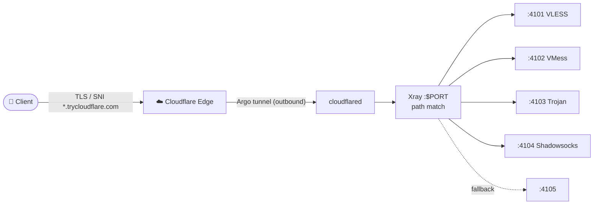

<div align="center">

# ⚡️ argoport

### Multi-protocol Xray node, dibungkus Cloudflare quick tunnel

*Dibuat untuk PaaS (Railway, Fly.io, Render) di mana kamu dapat container, bukan VM, dan tidak ada port inbound yang terbuka ke internet.*

<br>


<br>

[✨ Fitur](#-fitur) •
[🔌 Protokol](#-protokol) •
[🚀 Deploy](#-deploy-di-railway) •
[⚙️ Variabel](#️-variabel) •
[🌐 Alur Traffic](#-alur-traffic) •
[⚠️ Batasan](#️-batasan-yang-perlu-diketahui)

</div>

<br>

---

## 💡 Tentang

Cloudflare Argo tunnel itu **outbound-only**. Platform tidak perlu membuka port apa pun: `cloudflared` yang dial keluar ke Cloudflare, lalu CF mengembalikan traffic lewat koneksi yang sama.

> 🛡 **IP origin kamu tidak pernah muncul di DNS record.**

---

## ✨ Fitur

| | |
|---|---|
| 🔌 **4 protokol, 1 listener** | VLESS, VMess, Trojan, dan Shadowsocks dipisah lewat WebSocket path |
| 🚫 **Tanpa port inbound** | Semua koneksi outbound lewat Cloudflare Argo tunnel |
| 🙈 **IP origin tersembunyi** | Tidak ada IP asli di DNS record |
| 🆔 **Identitas stabil** | UUID otomatis diturunkan, tidak mati tiap redeploy |
| 🧩 **Zero config** | Deploy tanpa konfigurasi, langsung jalan |
| 🐳 **Dockerfile multi-stage** | Binary di-bake saat build, container start dalam hitungan detik |

---

## 🔌 Protokol

Keempatnya berbagi **satu listener publik** dan dipisah berdasarkan **WebSocket path**:

| Protokol | Path | Status |
|:--|:--|:--:|
| 🟢 **VLESS** | `/{root}-vless` | ⭐️ Direkomendasikan |
| 🟡 VMess | `/{root}-vmess` | ⚠️ Deprecated |
| 🔵 Trojan | `/{root}-trojan` | ✅ |
| 🟡 Shadowsocks | `/{root}-shadowsocks` | ⚠️ Deprecated |

> [!TIP]
> **VLESS adalah yang sebaiknya dipakai.** VMess dan Shadowsocks sudah deprecated di core Xray terbaru dan dipertahankan hanya demi kompatibilitas client.

## 🚀 Deploy di Railway

1. 📤 **Push** repo ini ke GitHub (kalau kamu fork, langsung loncat ke langkah 2).
2. 🚂 Di Railway pilih **New Project → Deploy from GitHub repo**, lalu pilih repo ini. `Dockerfile` terdeteksi otomatis, tidak ada konfigurasi Nixpacks yang perlu diurus.
3. 📜 Tunggu build sekitar satu menit, lalu buka tab **Deployments → View logs**. Setelah container start akan muncul blok link client.
4. 📋 **Copy** link VLESS ke client kamu. Selesai! 🎉

> [!NOTE]
> Tidak ada variabel yang wajib diisi. Deploy apa adanya sudah jalan.

---

## ⚙️ Variabel

Semua **opsional**. Deploy tanpa konfigurasi pun sudah menghasilkan node yang jalan dengan identitas stabil.

| Variabel | Default | Fungsi |
|:--|:--|:--|
| `ARGOPORT_ID` | *derived* | Identitas node. Isi hanya jika ingin menimpa nilai turunan. |
| `ARGOPORT_PATH` | `argo` | Root WebSocket path, tanpa slash di depan. |
| `ARGOPORT_TAG` | `matsumiko` | Menempel `-tag` di nama node **dan** path, jadi `argoport-vless-matsumiko` dengan path `/argo-vless-matsumiko`. Sudah ke-set di source, tinggal di-override kalau mau ganti label. |
| `ARGOPORT_LOG` | `warning` | Level log Xray. |
| `ARGOPORT_BIND` | `0.0.0.0` | Bind address. Railway wajib `0.0.0.0`. |
| `ARGOPORT_RUN_DIR` | `/data` | Direktori kerja untuk config dan state. Di container sudah di-set ke `/data` dan dimiliki user runtime. |
| `TELEGRAM_BOT_TOKEN` | *kosong* | Token bot Telegram. Isi bersama `TELEGRAM_CHAT_ID` untuk kirim link ke chat. |
| `TELEGRAM_CHAT_ID` | *kosong* | ID chat/channel tujuan. Lihat catatan di bawah. |
| `PORT` | `8080` | Di-inject oleh Railway. **Jangan di-set sendiri.** |

<details>
<summary><b>📨 Kirim link otomatis ke Telegram</b></summary>

<br>

Kalau **kedua** variabel di atas diisi, begitu node siap semua link dikirim ke
chat itu. Kalau salah satunya kosong, langkah ini dilewati dan node tetap jalan
normal.

```bash
TELEGRAM_BOT_TOKEN = 123456:ABC-DEF...   # dari @BotFather
TELEGRAM_CHAT_ID   = 6243379861
```

Cara dapetin `CHAT_ID`:

1. Kirim pesan apa pun ke bot kamu.
2. Buka `https://api.telegram.org/bot<TOKEN>/getUpdates`
3. Cari `message.chat.id` di response-nya.

Buat channel, pakai `@username_channel` sebagai `CHAT_ID` dan jadikan bot
sebagai admin channel-nya.

> [!NOTE]
> Link node itu **rahasia**. Jangan kirim ke grup publik — siapa pun yang punya
> link-nya bisa nyambung ke node kamu dan makan kuota tunnel-nya.

</details>

> [!WARNING]
> Kalau kamu mount volume sendiri, pastikan direktori `ARGOPORT_RUN_DIR` **writable oleh user runtime** (uid 10001). Kalau tidak, script akan berhenti di awal dengan pesan yang jelas, bukan crash loop.

---

## 🆔 Cara Identitas Dipilih

Node butuh sebuah UUID, dan UUID itu harus bertahan setelah redeploy, kalau tidak semua link tersimpan akan mati. Urutan resolusinya, **yang pertama cocok menang**:

| # | Sumber | Keterangan |
|:-:|:--|:--|
| 1️⃣ | **`ARGOPORT_ID`** | Override eksplisit, menang mutlak. |
| 2️⃣ | **Saved state** | Id yang sebelumnya sudah ditentukan dan disimpan di run directory. |
| 3️⃣ | **`RAILWAY_SERVICE_ID`** | Railway mengeksposnya ke setiap deployment dan nilainya stabil antar redeploy (hanya deployment id yang berubah). UUID diturunkan secara deterministik via SHA-1, jadi service yang sama selalu menghasilkan UUID yang sama. **Ini jalur deploy Railway yang normal.** |
| 4️⃣ | **Random** | Pilihan terakhir, dipakai saat jalan di luar Railway tanpa override. |

> ✅ **Hasilnya:** dua orang yang clone repo ini mendapat UUID berbeda, sedangkan redeploy satu orang selalu mempertahankan UUID yang sama. Tidak ada yang perlu dikonfigurasi.

Menyimpan id bersifat **best-effort** — kalau gagal ditulis, script tetap jalan dan id-nya diturunkan lagi dari `RAILWAY_SERVICE_ID` di boot berikutnya.

<details>
<summary><b>📌 Mau pin identitas secara manual?</b></summary>

<br>

```bash
cat /proc/sys/kernel/random/uuid
```

Paste hasilnya ke **Railway → Variables → `ARGOPORT_ID`**.

</details>

---

## 🖥 Jalankan di Tempat Lain

<details open>
<summary><b>🐳 Docker</b></summary>

<br>

```bash
docker build -t argoport .
docker run --rm -p 8080:8080 argoport
```

</details>

<details>
<summary><b>🧱 Langsung di host</b></summary>

<br>

Pastikan `xray` dan `cloudflared` ada di `PATH`, dan `ARGOPORT_RUN_DIR` menunjuk ke direktori writable:

```bash
PORT=8080 ARGOPORT_RUN_DIR=$(mktemp -d) ./entrypoint.sh
```

</details>

## 🌐 Alur Traffic



<details>
<summary><b>📜 Versi ASCII</b></summary>

<br>

```
client ──TLS/SNI *.trycloudflare.com──▶ Cloudflare edge
                                            │
                                   argo tunnel (outbound)
                                            │
                                   cloudflared ──▶ xray :$PORT
                                                      │ path match
                        ┌────────────────────┼────────────────────┬──────────┐
                   :4101 vless          :4102 vmess          :4103 trojan   :4104 ss
                                                                          :4105 fallback
```

</details>

Inbound tunggal Xray di `$PORT` membawa VLESS dengan `fallbacks`. Request yang WebSocket path-nya cocok dengan sebuah protokol diarahkan ke inbound loopback protokol tersebut, sisanya jatuh ke `:4105`.

Host kamuflase pada link yang dihasilkan adalah `www.digitalocean.com`. Client terhubung ke sana, tetapi **TLS SNI dan Host header membawa domain Cloudflare**, itulah yang sebenarnya dijawab oleh tunnel.

---

## ⚠️ Batasan yang Perlu Diketahui

> [!WARNING]
> **Hostname quick tunnel bersifat sementara.**
> `*.trycloudflare.com` hanya ada selama proses berjalan. Setiap restart menghasilkan hostname baru. Untuk hostname yang stabil, kamu butuh *named tunnel* yang terikat ke domain milikmu di Cloudflare: set `CF_TUNNEL_TOKEN` lalu ganti `start_tunnel` dengan `cloudflared tunnel run`.

> [!NOTE]
> **VMess dan Shadowsocks deprecated** di Xray 26.x. Keduanya masih jalan, dan warning di log adalah saran sungguhan, bukan error.

> [!CAUTION]
> **Rate limit.** Tunnel Cloudflare gratis bukan backbone. Cukup untuk traffic pribadi, tapi jangan dijadikan fondasi bisnis.

---

## 📁 Struktur File

```
argoport/
├── Dockerfile          # multi-stage build, binary di-bake saat build
├── entrypoint.sh       # render config, supervisi proses, emisi link
├── railway.json        # config service: Dockerfile builder, single instance
├── README.md
├── LICENSE             # MIT
├── .gitignore
└── .dockerignore
```

---

## 📄 Lisensi

**MIT.** © 2026 argoport. Fork, modifikasi, dan pakai sesukamu. Pull request selalu diterima! 💛

<div align="center">

<br>

⚡️ *Dibuat untuk container, bukan VM.*

</div>
